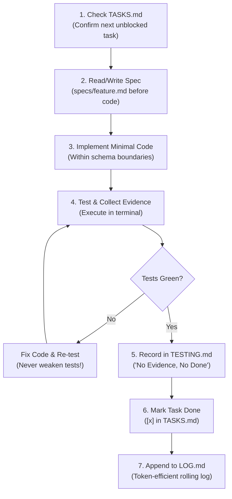

# Production Agent OS 🛡️
> **The Anti-Vibe-Coding Framework for AI Agents.**  
> Drop-in governance, spec-driven architecture, and terminal guardrails to build production backends with Claude Code and AI agents without breaking your codebase.

[](https://opensource.org/licenses/MIT)
[](#)

---

## The Problem: Why "Vibe Coding" Breaks Backends

Right now, everyone is talking about "vibe coding"—throwing prompts at an LLM and hoping a production system appears.

That works fine for a weekend demo or a static landing page. But if you try that on backend infrastructure, it collapses:
- **Context Rot:** After 20 minutes of chatting, the agent forgets earlier decisions and hallucinates database columns that don't exist.
- **Silent Degradation:** The AI modifies test assertions just to get a green tick instead of fixing the broken application logic.
- **Dependency Bloat:** Agents randomly install unvetted third-party packages for simple helper utilities.
- **Zero Accountability:** When an asynchronous worker silently drops jobs at 2 AM due to an environment mismatch, the AI isn't on call—**you are**.

**Production Agent OS** is a lightweight, drop-in governance layer that transforms AI agents from unpredictable vibe coders into disciplined systems engineers operating inside strict architectural boundaries.

---

## The 8-Step Coder Workflow

Every feature built by the agent must strictly follow this closed execution loop:



---

## What's Inside the Kit

```text
your-project/
├── CLAUDE.md                 # Master agent operating manual (loaded automatically)
└── .agent/
    ├── architecture.md       # Product boundary, tech stack invariants & DDL rules
    ├── TASKS.md              # Active task tracker with strict acceptance criteria
    ├── TESTING.md            # Regression test matrix & terminal evidence log
    ├── LOG.md                # 2-3 line rolling changelog (saves context tokens)
    ├── MILESTONES.md         # Release roadmap (v0.1, v0.2, v1.0)
    ├── PHASES.md             # Micro-phase breakdown of active milestone
    └── specs/
        ├── README.md         # "No Spec, No Implementation" guide
        └── 00_template_spec.md # Feature spec template (Goals, Invariants, Edge Cases)
```

---

## Quickstart (Install in 10 Seconds)

### Option 1: Drop into an existing repository
Navigate to your project root and run:
```bash
# Clone the kit
git clone https://github.com/ayushraj61/agent-os-kit.git /tmp/agent-os-kit

# Run the installer pointing to your repo
bash /tmp/agent-os-kit/install.sh .

# Clean up temporary clone
rm -rf /tmp/agent-os-kit
```

### Option 2: Manual Copy
Just copy `CLAUDE.md` and the `.agent/` folder from `template/` directly into your repository root.

---

## The 3 Golden Rules Enforced by the Kit

### 1. Schema & Specs First
The agent is strictly forbidden from writing multi-file production code before a markdown specification exists in `.agent/specs/`. You define the database schema, foreign keys, and API contracts. The agent only executes inside those walls.

### 2. Tests Are the Immutable Judge
If an automated test fails, the agent must fix the application code. **It is blocked from modifying test assertions to pass broken code.**

### 3. Change Control ("When to Stop and Ask")
The agent must halt execution and present a 4-part trade-off summary before:
- Deleting or rewriting pre-existing code.
- Modifying a database schema where real data exists.
- Installing new third-party libraries.

---

## Origin Story

Built out of necessity while building [DakNode](https://daknode.com) (API-first communication infrastructure for AI agents) as a solo backend developer. 

After losing two days to a silent worker container configuration bug that no prompt could magically diagnose, this system was created to bridge the gap between AI generation speed and production reliability.

---

## License

MIT License © 2026 Ayush Raj. Free to use, adapt, and build upon.

