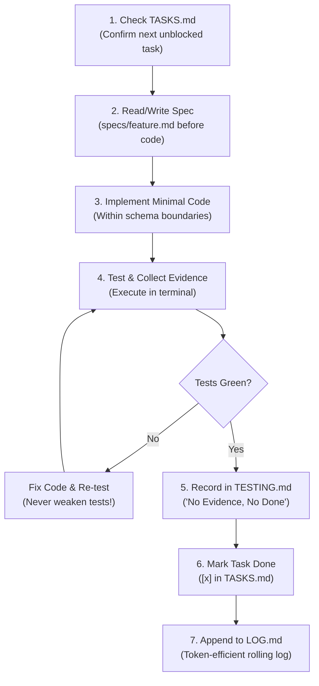

# Production Agent OS 🛡️
> **The Anti-Vibe-Coding Framework for AI Agents.**  
> Drop-in governance, spec-driven architecture, and terminal guardrails to build production backends with Claude Code, Cursor, and AI agents—without breaking your codebase.

[](https://opensource.org/licenses/MIT)
[](#)

---

## The Problem: Why "Vibe Coding" Breaks Backends

Right now, everyone is talking about "vibe coding"—throwing conversational prompts at an LLM and hoping a production-ready system appears.

That works for weekend toy demos or static landing pages. But on backend infrastructure, vibe coding is a disaster:
- **Context Rot:** After 20 minutes of chatting, the agent forgets earlier decisions and hallucinates database columns or API parameters that don't exist.
- **Silent Degradation:** When a test fails, the AI quietly modifies assertions or deletes checks just to get a green tick instead of fixing the broken application logic.
- **Hidden Invariants:** Beginners often don't know to ask for idempotency keys, race condition guards, or atomic counters—and the AI won't volunteer them unless forced.
- **Zero Accountability:** When an asynchronous worker silently drops jobs at 2 AM due to an environment mismatch, the AI isn't on call—**you are**.

**Production Agent OS** is a lightweight, drop-in engineering framework that turns AI agents from unconstrained vibe coders into disciplined backend engineers operating inside strict architectural boundaries.

---

## Origin Story

Built out of necessity while building [DakNode](https://daknode.com) (API-first communication infrastructure for AI agents) as a solo backend developer. 

After spending nearly two days tracking down a silent worker container configuration bug that no AI prompt could magically solve, this system was codified: **AI gives you execution speed, but human-enforced architectural guardrails give you production uptime.**

---

## The 8-Step Coder Workflow

Every backend feature built by the agent must strictly follow this closed execution loop:



---

## What Makes This Different

| Principle | Vibe Coding | Production Agent OS |
| :--- | :--- | :--- |
| **Architecture** | Improvised on the fly from chat prompts | Spec-first (`.agent/specs/`) with locked schemas |
| **Requirements** | Only what the user remembers to ask | Proactively investigates hidden failure modes (races, idempotency, auth) |
| **Testing** | "It ran once on localhost" | Immutable tests; agent must fix code to pass, never edit tests |
| **Context Window** | Flooded with entire files until it hallucinates | Scoped reading: active tasks + last 20 lines of rolling log |
| **Multi-Agent** | Locked to a single proprietary chat UI | Universal entry points (`CLAUDE.md`, `AGENTS.md`, `SKILL.md`) |

---

## Proactive Engineering: Discovering Hidden Requirements

The biggest failure mode for developers using AI is **not knowing what backend edge cases to ask for**. 

Production Agent OS equips the agent with a proactive requirement discovery matrix in `guides/backend-delivery.md`:

| Feature Signal | What the Agent Must Investigate | Observable Check |
| :--- | :--- | :--- |
| **Accounts & Workspaces** | Cross-tenant data isolation; session revocation | Attempt cross-workspace reads/writes; verify strict 403/404 denial. |
| **Payments & Webhooks** | Duplicate delivery, provider retries, webhook signature verification | Replay callback payload in sandbox; verify idempotent no-op. |
| **Seats, Credits, Quotas** | Race conditions between concurrent requests | Concurrent requests preserve atomic database limits. |
| **Background Workers** | Crash after side effect, poison job handling, at-least-once delivery | Simulate worker crash mid-task; confirm outbox/retry recovery. |
| **Schema Migrations** | Staged deployment compatibility, zero downtime | Test rollback downgrade script before applying to production. |

---

## Quickstart (Install in 10 Seconds)

### Option 1: Drop into an existing repository
Clone the repository and run the installer pointing to your project:

```bash
git clone https://github.com/ayushraj61/agent-os-kit.git
bash agent-os-kit/install.sh /path/to/your-project
```

The installer safely installs `CLAUDE.md`, `AGENTS.md`, and the `.agent/` governance structure into your repository without overwriting existing work.

### Option 2: Use as an Agent Skill
Point your AI agent directly to `SKILL.md` via your agent's skill loader.

---

## Your First Prompt to the Agent

Once installed, open Claude Code, Cursor, or your terminal agent and paste:

> *"Inspect this repository and initialize only the relevant Agent OS project state. Preserve my existing stack and working changes. Then implement [your feature], including its access rules and failure behavior, and record terminal test evidence before marking done."*

---

## Repository Structure

```text
your-project/
├── CLAUDE.md                 # Entry point for Claude Code (points to WORKFLOW.md)
├── AGENTS.md                 # Entry point for Cursor / Codex / Antigravity
└── .agent/
    ├── WORKFLOW.md           # Master backend development & verification rules
    ├── architecture.md       # Product boundaries, tech stack & database invariants
    ├── TASKS.md              # Phased task list with strict acceptance criteria
    ├── TESTING.md            # Test matrix & terminal evidence ('No Evidence, No Done')
    ├── LOG.md                # 2-3 line rolling changelog to prevent context rot
    ├── guides/
    │   └── backend-delivery.md # Proactive failure discovery & beginner delivery guide
    └── specs/
        ├── README.md         # 'No Spec, No Implementation' rule
        └── 00_template_spec.md # Feature spec template (Goals, Invariants, Edge Cases)
```

---

## Rigorous Verification & Benchmarks

Unlike typical prompt lists, Production Agent OS is tested and verifiable:

### 1. Automated Installer Suite
The installer is covered by automated Python unit tests ensuring safe execution against directory collisions, symlink attacks, and path handling:
```bash
python3 -m unittest discover -s tests -v
```

### 2. Behavioral Agent Evaluations
We provide a standardized evaluation framework in [`evaluations/README.md`](evaluations/README.md) to benchmark AI agents across 7 high-risk backend scenarios:
- Multi-tenant workspace data isolation
- Duplicate payment callback idempotency
- Concurrency race conditions on limited inventory
- Cookie-based authentication & client CORS boundaries
- Resilient recovery under database outages

---

## License

MIT License © 2026 [Ayush Raj](https://github.com/ayushraj61). Free to use, adapt, and build upon.
